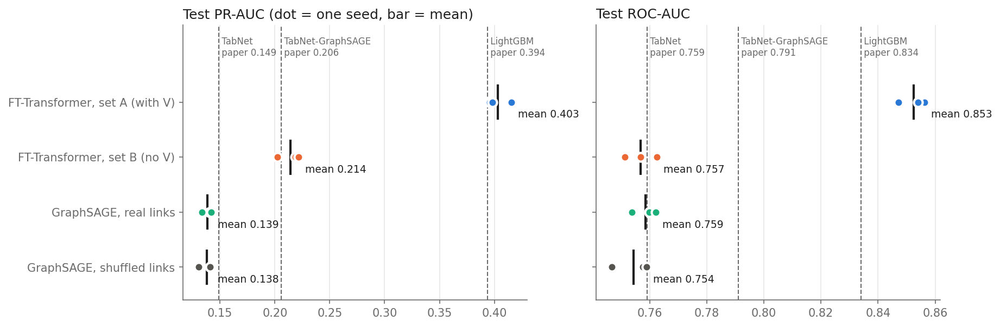
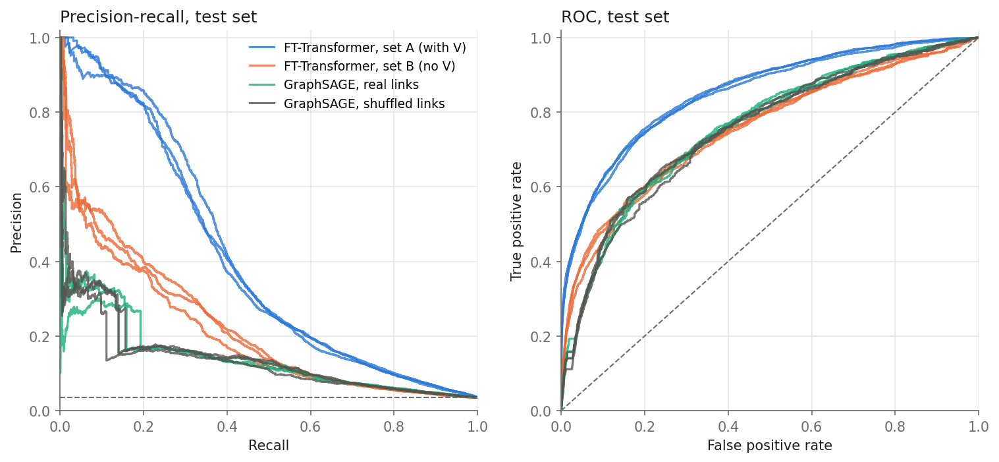
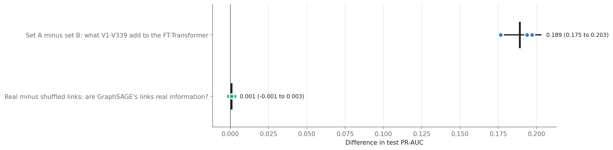

# FT-Transformer with graph neural networks for fraud detection (IEEE-CIS)

Does a graph of shared cards, addresses, e-mails and devices help a strong tabular model find fraud? This
repository holds one member's part of a five-person team study on the
[IEEE-CIS Fraud Detection](https://www.kaggle.com/competitions/ieee-fraud-detection) data, which builds on
Ahmad et al. (2026), *a hybrid TabNet–Graph neural network framework* ([doi](https://doi.org/10.1016/j.jfds.2026.100203)).

This part has two steps:
1. **Done: 12 training runs.** The **FT-Transformer** (Gorishniy et al., 2021), a Transformer for tables, on
   two column sets: with and without the 339 anonymous `V` columns. And **GraphSAGE** (Hamilton et al.,
   2017) on the team's shared entity graph, with the real links and with randomly shuffled links as a
   control. Three seeds each (42, 1, 2).
2. **Next: fusion.** The FT-Transformer combined with each of the team's four graph models: GraphSAGE,
   R-GCN, HAN and GAT (see [Fusion](#fusion-next-step)).

## Results

Test set: the last 15% of payments in time, scored once per run and never used to choose anything. Mean of
3 seeds, with the lowest and highest seed in brackets.

| Model | ROC-AUC | PR-AUC |
|---|---|---|
| FT-Transformer, all 390 columns (set A, with V) | 0.853 (0.847-0.856) | 0.403 (0.396-0.416) |
| FT-Transformer, 51 columns (set B, without V) | 0.757 (0.751-0.763) | 0.214 (0.202-0.222) |
| GraphSAGE, real links (no payment columns) | 0.759 (0.754-0.762) | 0.139 (0.133-0.142) |
| GraphSAGE, shuffled links | 0.754 (0.747-0.759) | 0.138 (0.131-0.142) |
| *Reference paper: LightGBM* | *0.834* | *0.394* |
| *Reference paper: hybrid TabNet-GraphSAGE* | *0.791* | *0.206* |

PR-AUC is the main score because only 3.5% of payments are fraud (guessing gives a PR-AUC of 0.035).

- The FT-Transformer with all columns is on par with the reference paper's best model (LightGBM), and well
  above its hybrid TabNet-GraphSAGE.
- The V columns nearly double the FT-Transformer's PR-AUC: +0.189 (95% interval 0.175 to 0.203, from
  2,000 paired bootstrap resamples of the test payments).
- GraphSAGE on the real graph scores the same as on shuffled links: +0.001 PR-AUC (95% interval -0.001 to
  0.003, which includes 0). On its own, the graph structure adds nothing measurable beyond each payment's
  own card, address, e-mail and device. Whether it helps *on top of* the FT-Transformer is what the fusion
  step tests.





More graphs (training curves, overfitting, frauds caught in the top 1% and 5%, set A vs B and real vs
shuffled with bootstrap intervals) are in [`01_results.ipynb`](01_results.ipynb) and
[`results/figures/`](results/figures/). Every run's score per epoch is in
`results/graph_vs_V/<run>_history.json`, and all 12 runs are in
[`results/graph_vs_V/runs.csv`](results/graph_vs_V/runs.csv).

## How the study is set up

Every member of the team uses the same data split, the same graph and the same rules, so scores from
different people's models can be compared and combined row by row (by TransactionID).

| | FT-Transformer | GraphSAGE |
|---|---|---|
| Data | 590,540 Kaggle training payments, sorted by time: 70% train, 15% validation, 15% test | same |
| Inputs | set A: the reference paper's 390 columns (369 numeric, 21 categorical); set B: the same without V1-V339 (51) | each payment's 6 entity nodes; no payment columns |
| Preprocessing | training medians, means and standard deviations; categories from training, unseen values become "unknown" | none |
| Model | 192-dimensional tokens, 3 pre-norm Transformer blocks, 8 heads, [CLS] head | node + entity-type embeddings (64), 2 mean layers, head 384 -> 128 -> 1 |
| Training | Adam (lr 0.001), batch 2,048, fraud-weighted cross-entropy, up to 80 epochs, stop 10 epochs after the best | same, 12 epochs, 10% of entities swapped for "unknown" in training |
| Epoch kept | best validation ROC-AUC | same |
| Saved | logit for every validation and test payment | same |

The full method, written for the paper, is in [`reports/method.md`](reports/method.md). Every setting and
decision, checked against the team plan, is in [`reports/plan.md`](reports/plan.md).

## What is in this repository

```
├── runs.py                 every training run by name (start here to read the code)
├── models.py               the FT-Transformer and GraphSAGE, one fit() and one predict()
├── common.py               loading the shared files, preprocessing, scoring, saving results
├── report.py               the tables and graphs of 01_results.ipynb
├── fusion.py               the team's shared fusion script, used unchanged (next step)
├── 00_train_runs.ipynb     Colab notebook that ran the 12 runs (with its output)
├── 01_results.ipynb        every table and graph of the results (with its output)
├── reports/
│   ├── method.md           the method paragraphs for the paper
│   ├── plan.md             settings, decisions and the check against the team plan
│   └── checks.md           checks of the shared data and graph files
├── results/
│   ├── graph_vs_V/         runs.csv, each run's history and training log, checkpoints/ (trained models)
│   ├── figures/            the graphs
│   ├── from_teammates/     R-GCN, HAN and GAT score files (in Drive only, see below)
│   └── fusion/             fusion results (next step)
├── data/README.md          where the data comes from (not included)
└── references/README.md    papers to cite
```

## Reproducing the runs

1. **Data.** Accept the competition rules on Kaggle and download the data. The runs need the team's two
   shared input files, built from it (a sorted 70/15/15 split and the entity graph, see
   [`data/README.md`](data/README.md)). They cannot be published, and the code checks their SHA-256 hashes,
   so a run only starts with the exact files the team used.
2. **Environment.** Python with PyTorch, NumPy, pandas, pyarrow, scikit-learn and matplotlib
   (`requirements.txt`). The results come from Google Colab on one NVIDIA A100 (Python 3.13, PyTorch
   2.14.1, CUDA 13.0). `requirements.lock.txt` is the exact local environment used for the checks.
3. **Run.**
   - In Google Colab: put this folder in Google Drive as `My Drive/IEEE Fraud Detection`, open
     `00_train_runs.ipynb`, choose a GPU (A100 or L4) and run all cells. Then open `01_results.ipynb` (no
     GPU needed) for the tables and graphs.
   - On a PC: `python runs.py checks`, `python runs.py smoke`, then `python runs.py all`.

   `checks` and `smoke` train nothing. `all` runs the 12 runs and skips finished ones; a finished result is
   never overwritten.
4. **Check.** The runs use deterministic GPU kernels and full 32-bit precision, and two identical runs give
   identical scores. Each history file stores the SHA-256 of the code, the input files, the score files and
   the checkpoint. Section A of `01_results.ipynb` recomputes every score from the saved files and marks it
   ✓ when it matches `runs.csv`.

The trained models are in `results/graph_vs_V/checkpoints/<run>.pt`. Each is a PyTorch `state_dict` for
`models.FTTransformer` or `models.GraphSAGE`, built as in `runs.py`. GraphSAGE also needs the shared graph
file.

## Fusion (next step)

The FT-Transformer will be combined with each graph model of the team, using the team's shared
[`fusion.py`](fusion.py) unchanged, so that every graph model is fused the same way:

- score = z(FT-Transformer) + alpha × z(graph), each model standardised on its own validation scores;
- alpha from 0 to 1 in steps of 0.025, chosen on validation PR-AUC (alpha = 0 is the FT-Transformer alone);
- the test set is scored once, with 2,000 paired bootstrap resamples. A graph counts as helping only if
  (1) the 95% interval of the gain is above 0, (2) the gain is larger than the spread between seeds, and
  (3) the real graph beats the shuffled graph.

| Graph model | Scores | Fusion with the FT-Transformer |
|---|---|---|
| GraphSAGE | this repository | to do |
| R-GCN | from a teammate, received | to do |
| HAN | from a teammate, received | to do |
| GAT | from a teammate, coming | to do |

The results will go to [`results/fusion/`](results/fusion/). The teammates' score files are not published
here, because they contain the Kaggle labels.

## Data and licences

- **Code:** MIT licence ([`LICENSE`](LICENSE)). `fusion.py` was written by the team for shared use and is
  included with the team's agreement.
- **Data:** IEEE-CIS Fraud Detection, Kaggle. Under the competition rules it may be used for non-commercial
  purposes only (including academic research and education) and may not be redistributed. So it is not
  included, and neither is any file that contains it (the split, the graph files and the score files).
- **Trained models and results** (`results/`): these come from training on the Kaggle data. They are shared
  for non-commercial research and education, in line with the data's terms.

## References

- Ahmad, H., Bhuiyan, I., Bhuiyan, T. and Hoque, A. (2026). Scalable and interpretable fraud detection in
  FinTech: Evidence from a hybrid TabNet–Graph neural network framework. *The Journal of Finance and Data
  Science*, 12, 100203. <https://doi.org/10.1016/j.jfds.2026.100203>
- Gorishniy, Y., Rubachev, I., Khrulkov, V. and Babenko, A. (2021). Revisiting deep learning models for
  tabular data. *NeurIPS 2021*.
- Hamilton, W. L., Ying, R. and Leskovec, J. (2017). Inductive representation learning on large graphs.
  *NeurIPS 2017*.
